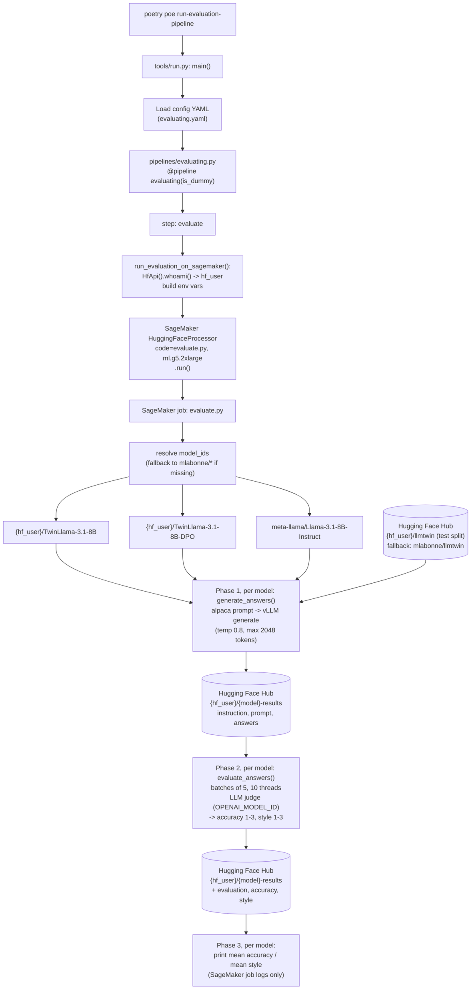

# `evaluating` Pipeline

Triggered by `poetry poe run-evaluation-pipeline`. This pipeline runs *after* `training`. It launches an AWS SageMaker **Processing** job that generates answers with three models (your SFT model, your DPO model, and the `Llama-3.1-8B-Instruct` baseline) on the `test` split of the instruct dataset, scores each answer with an LLM judge (GPT-4o-mini by default) for accuracy and style, and prints an average score per model.

## Pipeline task

There is a single, non-composite poe task ([pyproject.toml:90](../pyproject.toml#L90)):

```toml
run-evaluation-pipeline = "poetry run python -m tools.run --no-cache --run-evaluation"
```

- `--run-evaluation` tells [main()](../tools/run.py#L113) to execute the `if run_evaluation:` branch ([tools/run.py:192-196](../tools/run.py#L192-L196)), which loads [configs/evaluating.yaml](../configs/evaluating.yaml)
- `--no-cache` disables ZenML step caching for the run

The config has a single parameter:

| Parameter | `evaluating.yaml` | Notes |
| --- | --- | --- |
| `is_dummy` | `true` | Evaluates only the first 10 test samples per model (see Key read) |

The model and dataset namespaces are **not** in the config. Both come from the account that owns `HUGGINGFACE_ACCESS_TOKEN` (see Key read).

The step needs `HUGGINGFACE_ACCESS_TOKEN`, `OPENAI_API_KEY` and `AWS_ARN_ROLE` (all three are asserted in [sagemaker.py:18-20](../llm_engineering/model/evaluation/sagemaker.py#L18-L20)), and the AWS extras installed (`poetry install --with aws`). The token must have access to the gated `meta-llama/Llama-3.1-8B-Instruct` repo and write access to your own namespace. `OPENAI_BASE_URL` and `OPENAI_MODEL_ID` are forwarded to the job, so the judge can be any OpenAI-compatible endpoint.

## Diagram



## Key read

Three things about this pipeline aren't obvious from the poe task:

1. **The ZenML pipeline is only a launcher, and the results never reach ZenML.** Like `training`, it has one step, `evaluate`, which returns `None`. The step builds a SageMaker `HuggingFaceProcessor` and calls `.run()` ([sagemaker.py:44-59](../llm_engineering/model/evaluation/sagemaker.py#L44-L59)). It is a Processing job, not a Training job, so it doesn't go through Comet ML either. The real work happens in [evaluate.py](../llm_engineering/model/evaluation/evaluate.py) on an `ml.g5.2xlarge` GPU instance. There are two outputs:
   - One Hub dataset per model, `{hf_user}/{model}-results`, holding each instruction, the model's answer, the judge's raw JSON, and the `accuracy` / `style` scores.
   - The final averages, which are only `print`ed ([evaluate.py:224-231](../llm_engineering/model/evaluation/evaluate.py#L224-L231)). To see them, read the job's logs in CloudWatch (log group `/aws/sagemaker/ProcessingJobs`, job name prefix `evaluate-llm-twin`), or compute them yourself from the results datasets.

2. **Every namespace comes from the token owner, and everything silently falls back to `mlabonne`.** The launcher sets both `DATASET_HUGGINGFACE_WORKSPACE` and `MODEL_HUGGINGFACE_WORKSPACE` to `HfApi().whoami()` ([sagemaker.py:27-39](../llm_engineering/model/evaluation/sagemaker.py#L27-L39)). `training` reads datasets from `dataset_huggingface_workspace` in its config instead, so this pipeline has nothing equivalent to that setting. Then:
   - If `{hf_user}/TwinLlama-3.1-8B` or `{hf_user}/TwinLlama-3.1-8B-DPO` doesn't exist, the job evaluates `mlabonne/TwinLlama-3.1-8B` or `mlabonne/TwinLlama-3.1-8B-DPO` instead ([evaluate.py:201-209](../llm_engineering/model/evaluation/evaluate.py#L201-L209)).
   - If `{hf_user}/llmtwin` doesn't exist, it uses `mlabonne/llmtwin` ([evaluate.py:214-216](../llm_engineering/model/evaluation/evaluate.py#L214-L216)).
   - The fallbacks only print a message and don't stop the job, so check the job log for `Defaulting to` before you trust the scores.

   Results always go to your own namespace, so a fallback run still writes `{hf_user}/TwinLlama-3.1-8B-results`, which looks exactly like a run on your own model.

3. **Only the instruct dataset's `test` split is used.** This is the 10% split `generate_datasets` held back and `training` never touched. The preference (`llmtwin-dpo`) dataset isn't used, so the DPO model is judged on the same instructions as the SFT model. The models are compared, not tested against reference answers. The judge scores each answer on its own, with no access to the dataset's ground-truth `output`.

Other details worth knowing:

- **Dummy mode.** With `is_dummy: true` the launcher sets `IS_DUMMY=True` and each model answers only the first 10 test samples ([evaluate.py:35-39](../llm_engineering/model/evaluation/evaluate.py#L35-L39)). With `false` the variable is left unset, so the full `test` split is used.
- **The baseline gets the wrong prompt format.** All three models receive the same Alpaca-style `### Instruction: / ### Response:` text ([evaluate.py:29-32](../llm_engineering/model/evaluation/evaluate.py#L29-L32)) as a raw completion. That matches how the TwinLlama models were fine-tuned, but `Llama-3.1-8B-Instruct` expects its own chat template. This tilts the comparison in favour of the TwinLlama models.
- **The scores are noisy.** Generation samples at `temperature=0.8` and the judge runs at `temperature=0.9` ([evaluate.py:45](../llm_engineering/model/evaluation/evaluate.py#L45), [evaluate.py:104](../llm_engineering/model/evaluation/evaluate.py#L104)), so two runs on 10 dummy samples can give noticeably different averages.
- **One bad judge reply can crash the job.** The post-processing stores `None` when a score is missing ([evaluate.py:153-156](../llm_engineering/model/evaluation/evaluate.py#L153-L156)), but the final `sum(dataset["accuracy"])` then raises `TypeError`. An API error or malformed JSON inside `evaluate_answer()` is re-raised by `future.result()` and also stops the job. Because phase 1 has already pushed the answers, you can re-run only phases 2 and 3 instead of generating again.
- **`OPENAI_BASE_URL` may break the job launch when it's unset.** The launcher puts `settings.OPENAI_BASE_URL` (default `None`) straight into the job's `env` ([sagemaker.py:35](../llm_engineering/model/evaluation/sagemaker.py#L35)). SageMaker environment values must be strings, so if the variable isn't set in `.env` the request is likely to be rejected at `.run()`. Setting it to an empty string works, because `evaluate.py` treats empty as "use the default endpoint" ([evaluate.py:14](../llm_engineering/model/evaluation/evaluate.py#L14)). This hasn't been confirmed by a run yet.
- **Judge cost.** The job makes one judge call per answer: 3 models × N test samples (30 calls in dummy mode). With the default `gpt-4o-mini` this is cheap, but a larger `OPENAI_MODEL_ID` multiplies it.

## Function call reference

| Diagram node | Function | Location |
| --- | --- | --- |
| `main()` | `main()` | [tools/run.py:113](../tools/run.py#L113) |
| branch that builds and runs the pipeline | `if run_evaluation:` block | [tools/run.py:192-196](../tools/run.py#L192-L196) |
| `evaluating(is_dummy)` | `evaluating()` | [pipelines/evaluating.py:7](../pipelines/evaluating.py#L7) |
| `step: evaluate` | `evaluate()` | [steps/evaluating/evaluate.py:7](../steps/evaluating/evaluate.py#L7) |
| → resolve HF user, build env, `.run()` | `run_evaluation_on_sagemaker()` | [llm_engineering/model/evaluation/sagemaker.py:17](../llm_engineering/model/evaluation/sagemaker.py#L17) |
| resolve `model_ids` (with fallback) | `check_if_huggingface_model_exists()` | [evaluate.py:171](../llm_engineering/model/evaluation/evaluate.py#L171) |
| resolve dataset (with fallback) | `check_if_huggingface_dataset_exists()` | [evaluate.py:186](../llm_engineering/model/evaluation/evaluate.py#L186) |
| SageMaker job entry point (3 phases) | `if __name__ == "__main__":` block | [evaluate.py:211](../llm_engineering/model/evaluation/evaluate.py#L211) |
| Phase 1: `generate_answers()` (vLLM) | `generate_answers()` | [evaluate.py:28](../llm_engineering/model/evaluation/evaluate.py#L28) |
| Phase 2: `evaluate_answers()` (thread pool) | `evaluate_answers()` | [evaluate.py:116](../llm_engineering/model/evaluation/evaluate.py#L116) |
| → one batch of 5, one OpenAI client | `evaluate_batch()` | [evaluate.py:111](../llm_engineering/model/evaluation/evaluate.py#L111) |
| → judge prompt + JSON response | `evaluate_answer()` | [evaluate.py:58](../llm_engineering/model/evaluation/evaluate.py#L58) |
| Phase 3: print mean accuracy / style | loop at end of `__main__` | [evaluate.py:224-231](../llm_engineering/model/evaluation/evaluate.py#L224-L231) |

## Relevant files

- [pyproject.toml](../pyproject.toml): `run-evaluation-pipeline` poe task definition
- [tools/run.py](../tools/run.py): CLI entry point
- [configs/evaluating.yaml](../configs/evaluating.yaml): evaluation pipeline parameters (`is_dummy` only)
- [pipelines/evaluating.py](../pipelines/evaluating.py): ZenML pipeline definition
- [steps/evaluating/evaluate.py](../steps/evaluating/evaluate.py)
- [llm_engineering/model/evaluation/sagemaker.py](../llm_engineering/model/evaluation/sagemaker.py): builds and launches the SageMaker Processing job
- [llm_engineering/model/evaluation/evaluate.py](../llm_engineering/model/evaluation/evaluate.py): script that runs on SageMaker (vLLM generation, LLM-as-judge scoring)
- [llm_engineering/model/evaluation/requirements.txt](../llm_engineering/model/evaluation/requirements.txt): packages installed in the SageMaker container (`vllm`, `openai`, `datasets`, …)
- [llm_engineering/settings.py](../llm_engineering/settings.py): `OPENAI_MODEL_ID` (default `gpt-4o-mini`), `OPENAI_BASE_URL`, `HUGGINGFACE_ACCESS_TOKEN`, `AWS_ARN_ROLE`
