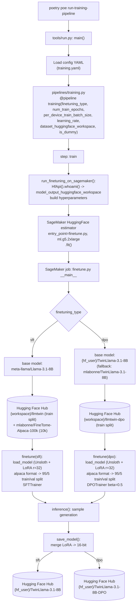

# `training` Pipeline

Triggered by `poetry poe run-training-pipeline`. This is the pipeline that runs *after* `generate_datasets` — it launches an AWS SageMaker job that pulls the instruct (SFT) or preference (DPO) dataset from the Hugging Face Hub, fine-tunes Llama 3.1 8B with Unsloth + LoRA, and pushes the merged model back to the Hub.

## Pipeline task

There is a single, non-composite poe task ([pyproject.toml:89](../pyproject.toml#L89)):

```toml
run-training-pipeline = "poetry run python -m tools.run --no-cache --run-training"
```

- `--run-training` — tells [main()](../tools/run.py#L113) to execute the `if run_training:` branch ([tools/run.py:186-190](../tools/run.py#L186-L190)), which loads [configs/training.yaml](../configs/training.yaml)
- `--no-cache` — disables ZenML step caching for the run

The config's `finetuning_type` decides which stage runs. To train both stages, run the task once with `sft`, then change it to `dpo` and run it again:

| Parameter | `training.yaml` | Notes |
| --- | --- | --- |
| `finetuning_type` | `sft` | `sft` or `dpo` |
| `num_train_epochs` | `3` | SFT only; DPO hard-codes `1` |
| `per_device_train_batch_size` | `2` | SFT and DPO |
| `learning_rate` | `3e-4` | SFT only; DPO hard-codes `2e-6` |
| `dataset_huggingface_workspace` | `mryoussef79` | Hub namespace the datasets are loaded from |
| `is_dummy` | `true` | 1 epoch, 400 samples (see Key read) |

The step needs `HUGGINGFACE_ACCESS_TOKEN` and `AWS_ARN_ROLE`, and the AWS extras installed (`poetry install --with aws`). The token must have access to the gated `meta-llama/Llama-3.1-8B` repo and write access to your own namespace. `COMET_API_KEY` and `COMET_PROJECT` are forwarded to the job for experiment tracking.

## Diagram



## Key read

Two things about this pipeline aren't obvious from the poe task:

1. **The ZenML pipeline is only a launcher.** It has one step, `train`, which returns `None` and produces no artifact. The step builds a SageMaker `HuggingFace` estimator and calls `.fit()` ([sagemaker.py:50-69](../llm_engineering/model/finetuning/sagemaker.py#L50-L69)). The actual training runs in [finetune.py](../llm_engineering/model/finetuning/finetune.py) on an `ml.g5.2xlarge` GPU instance, and the config values reach it as command-line arguments. Training metrics go to Comet ML, not ZenML.

2. **Data and models move through the Hugging Face Hub, not ZenML.** The job loads `{dataset_huggingface_workspace}/llmtwin` or `.../llmtwin-dpo` by name, from `main` with no pinned revision ([finetune.py:101](../llm_engineering/model/finetuning/finetune.py#L101), [finetune.py:154](../llm_engineering/model/finetuning/finetune.py#L154)). It never reads the `instruct_datasets` / `preference_datasets` ZenML artifacts. The input and output namespaces come from different places:
   - Datasets are read from `dataset_huggingface_workspace` in the config. It is set to `mryoussef79`, so training uses the datasets that `generate_datasets` pushed. Set it back to `mlabonne` to train on the book author's published datasets.
   - Models are pushed to the account that owns `HUGGINGFACE_ACCESS_TOKEN`, resolved with `HfApi().whoami()` ([sagemaker.py:33-35](../llm_engineering/model/finetuning/sagemaker.py#L33-L35)).

   SFT and DPO are chained through the Hub as well. DPO starts from `{hf_user}/TwinLlama-3.1-8B`, and if that model doesn't exist it silently falls back to `mlabonne/TwinLlama-3.1-8B` ([finetune.py:226-237](../llm_engineering/model/finetuning/finetune.py#L226-L237)). Run SFT first.

Also note that the config doesn't control everything it appears to. The SFT call in `__main__` doesn't pass `is_dummy` ([finetune.py:281-289](../llm_engineering/model/finetuning/finetune.py#L281-L289)), so `finetune()` falls back to its default `is_dummy=True` and SFT always runs 1 epoch on 400 samples, even with `is_dummy: false`. DPO hard-codes `num_train_epochs=1` and `learning_rate=2e-6` ([finetune.py:302-311](../llm_engineering/model/finetuning/finetune.py#L302-L311)). Only the `train` split of each Hub dataset is used, and it is split again 95/5 into train and validation for the trainer. The `test` split from `generate_datasets` is left for the `evaluating` pipeline. SFT also mixes in 10,000 samples from `mlabonne/FineTome-Alpaca-100k` to preserve general instruction-following.

## Function call reference

| Diagram node | Function | Location |
| --- | --- | --- |
| `main()` | `main()` | [tools/run.py:113](../tools/run.py#L113) |
| branch that builds and runs the pipeline | `if run_training:` block | [tools/run.py:186-190](../tools/run.py#L186-L190) |
| `training(...)` | `training()` | [pipelines/training.py:7](../pipelines/training.py#L7) |
| `step: train` | `train()` | [steps/training/train.py:7](../steps/training/train.py#L7) |
| → resolve HF user, build estimator, `.fit()` | `run_finetuning_on_sagemaker()` | [llm_engineering/model/finetuning/sagemaker.py:17](../llm_engineering/model/finetuning/sagemaker.py#L17) |
| SageMaker job entry point | `if __name__ == "__main__":` block | [llm_engineering/model/finetuning/finetune.py:240](../llm_engineering/model/finetuning/finetune.py#L240) |
| → SFT branch (base model, output repo) | `if args.finetuning_type == "sft":` | [finetune.py:275](../llm_engineering/model/finetuning/finetune.py#L275) |
| → DPO branch (base model, output repo) | `elif args.finetuning_type == "dpo":` | [finetune.py:294](../llm_engineering/model/finetuning/finetune.py#L294) |
| → fallback to `mlabonne/TwinLlama-3.1-8B` | `check_if_huggingface_model_exists()` | [finetune.py:226](../llm_engineering/model/finetuning/finetune.py#L226) |
| `load_model` (Unsloth + LoRA + chat template) | `load_model()` | [finetune.py:29](../llm_engineering/model/finetuning/finetune.py#L29) |
| `finetune(sft)` / `finetune(dpo)` | `finetune()` | [finetune.py:61](../llm_engineering/model/finetuning/finetune.py#L61) |
| → SFT dataset load + `SFTTrainer` | `if finetuning_type == "sft":` | [finetune.py:91](../llm_engineering/model/finetuning/finetune.py#L91) |
| → DPO dataset load + `DPOTrainer` | `elif finetuning_type == "dpo":` | [finetune.py:144](../llm_engineering/model/finetuning/finetune.py#L144) |
| `inference()` | `inference()` | [finetune.py:204](../llm_engineering/model/finetuning/finetune.py#L204) |
| `save_model()` (merge to 16-bit + push) | `save_model()` | [finetune.py:218](../llm_engineering/model/finetuning/finetune.py#L218) |

## Relevant files

- [pyproject.toml](../pyproject.toml) — `run-training-pipeline` poe task definition
- [tools/run.py](../tools/run.py) — CLI entry point
- [configs/training.yaml](../configs/training.yaml) — training pipeline parameters
- [pipelines/training.py](../pipelines/training.py) — ZenML pipeline definition
- [steps/training/train.py](../steps/training/train.py)
- [llm_engineering/model/finetuning/sagemaker.py](../llm_engineering/model/finetuning/sagemaker.py) — builds and launches the SageMaker training job
- [llm_engineering/model/finetuning/finetune.py](../llm_engineering/model/finetuning/finetune.py) — training script that runs on SageMaker (Unsloth, TRL `SFTTrainer` / `DPOTrainer`)
- [llm_engineering/model/finetuning/requirements.txt](../llm_engineering/model/finetuning/requirements.txt) — packages installed in the SageMaker container
